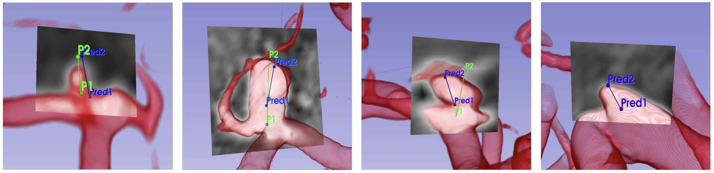
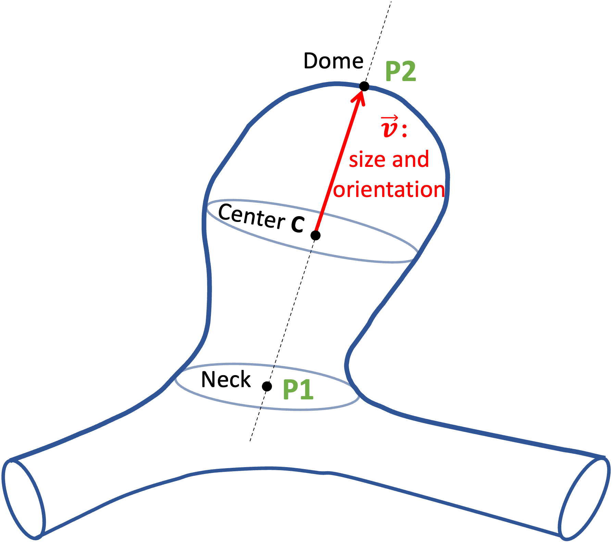

# Aneurysm Pose Estimation with Deep Learning
This repository contains the official code related to the paper titled '[Aneurysm Pose Estimation with Deep Learning](https://link.springer.com/chapter/10.1007/978-3-031-43895-0_51)', along with the annotations used for the public dataset [3]. The paper has been accepted at the 26th International Conference on Medical Image Computing and Computer Assisted Intervention (MICCAI) 2023.

# Abstract
The diagnosis of unruptured intracranial aneurysms from time-of-flight Magnetic Resonance Angiography (TOF-MRA) images is a challenging clinical problem that is extremely difficult to automate. We propose to go beyond the mere detection of each aneurysm and also estimate its size and the orientation of its main axis for an immediate visualization in appropriate reformatted cut planes. To address this issue, and inspired by the idea behind YOLO architecture, a novel one-stage deep learning approach is described to simultaneously estimate the localization, size and orientation of each aneurysm in 3D images. It combines fast and approximate annotation, data sampling and generation to tackle the class imbalance problem, and a cosine similarity loss to optimize the orientation. We evaluate our approach on two large datasets containing 416 patients with 317 aneurysms using a 5-fold cross-validation scheme. Our method achieves a median localization error of 0.48 mm and a median 3D orientation error of 12.27 degrees, demonstrating an accurate localization of aneurysms and an orientation estimation that comply with clinical practice. Further evaluation is performed in a more classical detection setting to compare with state-of-the-art nnDetecton[1] and nnUNet[2] methods. Competitive performance is reported with an average precision of 76.60%, a sensitivity score of 82.93%, and 0.44 false positives per case.

# Visual Results
Some qualitative results of our method on dataset [3]: predicted (blue) and GT (green) markups. Each reformatted cut plane was determined by rotating around the aneurysm axis passing through the predicted markups. The following 3D slicer extension is developed and used to visualise these results: https://gitlab.inria.fr/yassis/slicer-reformat-aneurysm. 



# Annotation 
To address the limitations associated with voxel-wise annotation, a weak annotation approach is employed for aneurysm labeling. This method entails approximating the aneurysm shape by utilizing spheres. As depicted in the figure below, the creation of these spheres involves the utilization of two reference points: the center of the aneurysm neck (P1) and the aneurysm dome (P2). Guided by these two points, a sphere is generated to approximate the aneurysm volume. 

To simplify the placement of the two points in the volume rendering view, we developed a Python extension for the 3D Slicer software, which provides a real-time visualization of the sphere in the canonical cut planes: https://gitlab.inria.fr/yassis/slicer-sphere-annotation.

<div align="center">
    
</div>


# Project Description
The project is structured into two main directories: "Data_dir" and "Work_dir". The "Data_dir" contains patient-related (subjects) data (e.g., P0001, P0002, etc.), while the "Work_dir" serves as the working directory and houses training samples for custom training, labeled as Train001, Train002, and so on.

In the "Data_dir", each patient's folder consists of multiple files. These include:
* volume.nii.gz: a 3D MRA image containing the patient's vascular data.
* aneurysm.csv: a CSV file specifying the 3D coordinates of points (P1, P2) used to annotate each aneurysm within the patient's anatomy. See [examples](https://gitlab.inria.fr/yassis/DeepAnePose/-/tree/main/reproductibility/Annotations) for dataset [3].
* noskull.nii.gz: a brain volume file excluding the skull. This file can be generated using [this script](https://gitlab.inria.fr/yassis/DeepAnePose/-/blob/main/resources/scripts/removeSkull.py), and used to generate "points.csv" files.
* points.csv: a CSV file listing the center coordinates of candidate negative (aneurysm-free) patches utilized for training. This file can be generated using [this script](https://gitlab.inria.fr/yassis/DeepAnePose/-/blob/main/resources/scripts/extractPoints.py).
* config.json: all the above files are organized and managed through the "config.json" file.
    ``` 
    {
        "init volume": "volume.nii.gz",
        "pts aneurysm": "aneurysm.csv",
        "noskull volume": "noskull.nii.gz",
        "patch centers": "points.csv"
    }
    ```

The "Work_dir" directory is designed to store training samples, such as the "Train001" directory that encapsulates the configuration for customized training. Each of these directories can be created using [this script](https://gitlab.inria.fr/yassis/DeepAnePose/-/blob/main/resources/scripts/prepare.py) and will include the following files:
* ndl_config.json: This file stores the configuration of the training sample, storing key-value pairs for essential settings such as the model architecture, loss function, batch size, number of epochs, and other relevant parameters.
* last_model.pytorch: As the training progresses, this file will continuously update and store the model checkpoint of the last epoch.
* best_model.pytorch: This file saves the model checkpoint that corresponds to the best performance according to specified metrics or the loss function. It represents the optimal model achieved during training.
* Predictions: This folder is created to contain the model predictions once the inference process is executed using [this script](https://gitlab.inria.fr/yassis/DeepAnePose/-/blob/main/resources/scripts/predict.py). It holds the output generated by the trained model for evaluation or further analysis.

By utilizing this directory structure, you can conveniently manage your data, training samples, configurations, and model checkpoints in a systematic manner.

# Usage
To use our code, follow the following steps:
### Preparation
1. Clone the repository by running the following commands:
    ```
    git clone https://gitlab.inria.fr/yassis/DeepAnePose.git
    cd DeepAnePose
    ```
2. Install the project with [uv](https://docs.astral.sh/uv/) (`--extra cu126` for an NVIDIA GPU, `--extra cpu` otherwise); the commands below then run from the repository folder with `uv run`:
    ```
    uv sync --extra cu126
    ```
3. Generate the "noskull.nii.gz" file: Use the "[removeSkull.py](https://gitlab.inria.fr/yassis/DeepAnePose/-/blob/main/resources/scripts/removeSkull.py).py" file to remove the skull from the patient's data. Execute the following command:
    ```
    uv run python scripts/remove_skull.py
    ```
4. Generate the "points.csv" file: Utilize the "[extractPoints.py](https://gitlab.inria.fr/yassis/DeepAnePose/-/blob/main/resources/scripts/extractPoints.py)" file to extract the relevant negative patches center from each patient's data. Execute the following command:
    ```
    uv run python scripts/extract_points.py
    ```

### Traning
1. After creating the patient data, the next step is to generate a customized training sample, such as the "Train001" directory. To accomplish this, edit the "[prepare.py](https://gitlab.inria.fr/yassis/DeepAnePose/-/blob/main/resources/scripts/prepare.py)" file and execute the following command:
   ```
    uv run python scripts/prepare.py
    ```
2. Once this is done, you will have a configuration file generated in the "Train001/ndl_config.json" location. This configuration file will serve as the basis for training.
To start (or resume) the training phase, we will use the "[train.py](https://gitlab.inria.fr/yassis/DeepAnePose/-/blob/main/resources/scripts/train.py)" file:
    ```
    uv run python scripts/train.py path/to/Train001
    ```
### Inference
- Based on the models checkpoints generated after training, use the script "[predict.py](https://gitlab.inria.fr/yassis/DeepAnePose/-/blob/main/resources/scripts/predict.py)" to perform inference by running:
    ```
    uv run python scripts/predict.py path/to/Train001
    ```
    The generated predictions can be found in the "path/to/Train001/**Predictions**" directory. The predictions for each patient are saved in a separate JSON file. Each prediction contains the following information:<br>
    - Center coordinates of the aneurysm neck (P1) in mm;
    - Center coordinates of the aneurysm dome (P2) in mm;
    - Center coordinates of the aneurysm in mm;
    - Aneurysm radius in mm;
    - Confidence score as a percentage;
        ```
        {
            "0": {
                "P1": [x, y, z],
                "P2": [x, y, z],,
                "center": [x, y, z],,
                "radius": 2.860074921453313,
                "confidence": 0.9962142109870911
            }
        }
        ```
### Evaluation
- To evaluate the performance of the model (i.e., generated Predictions) compared to the ground truth annotations, use the file "[evaluate.py](https://gitlab.inria.fr/yassis/DeepAnePose/-/blob/main/resources/scripts/evaluate.py)" and run the following command:
    ```
    uv run python scripts/evaluate.py path/to/Train001
    ```
    After running the evaluation script, the results will be generated are generated as a PNG figure that summarizes the performance of the model based on multiple metrics (pose estimation and object detection). The figure can be found in the "path/to/Train001/Predictions/**Evaluation\@0.1.png**" directory.
    
     


# Reproductibity
To ensure the reproducibility of our work, we have made the annotations of the subjects used in dataset [3] accessible at 
'[reproducibility/Annotations](https://gitlab.inria.fr/yassis/DeepAnePose/-/tree/main/reproductibility/Annotations)'. 
Each subject file contains the aneurysms annotation, represented by two points (P1, P2) with 3D coordinates (x, y, z).
Note that the subjects of dataset [3] can be downloaded from : https://openneuro.org/datasets/ds003949/ .


Furthermore, to replicate the 5-fold cross-validation methodology used in our experimental study, the subjects utilized in each fold can be found at '[reproducibility/Fold?.json](https://gitlab.inria.fr/yassis/DeepAnePose/-/tree/main/reproductibility)", where "?" represents the specific fold number. Each file contains the list of training and test subjects.

# Citation
If you find this repository useful in your research, please consider citing:
```
@inproceedings{assis2023aneurysm,
  title={Aneurysm Pose Estimation with Deep Learning},
  author={Assis, Youssef and Liao, Liang and Pierre, Fabien and Anxionnat, Ren{\'e} and Kerrien, Erwan},
  booktitle={International Conference on Medical Image Computing and Computer-Assisted Intervention},
  pages={543--553},
  year={2023},
  organization={Springer}
}

@inproceedings{assis2021efficient,
  title={An efficient data strategy for the detection of brain aneurysms from MRA with deep learning},
  author={Assis, Youssef and Liao, Liang and Pierre, Fabien and Anxionnat, Ren{\'e} and Kerrien, Erwan},
  booktitle={Deep Generative Models, and Data Augmentation, Labelling, and Imperfections: First Workshop, DGM4MICCAI 2021, and First Workshop, DALI 2021, Held in Conjunction with MICCAI 2021, Strasbourg, France, October 1, 2021, Proceedings 1},
  pages={226--234},
  year={2021},
  organization={Springer}
}
```

# References
[1] Baumgartner et al, nndetection: A self-configuring method for medical object detection. In: International Conference on Medical Image Computing and Computer-Assisted Intervention. pp. 530–539. Springer (2021).

[2] Isensee et al, nnU-Net: a self-configuring method for deep learning-based biomedical image segmentation, Nature methods 18(2), 203–211 (2021).

[3] Di Noto et al, Towards automated brain aneurysm detection in TOF-MRA: open data, weak labels, and anatomical knowledge. Neuroinformatics, pp. 1-14, (2022).

# Acknowledgements
This work was founded by Region Grand-Est and CHRU University hospital of Nancy, France.
