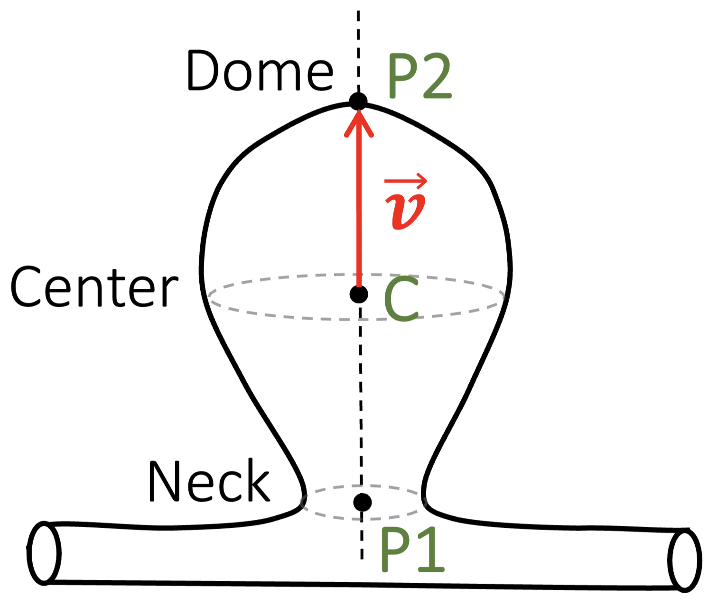
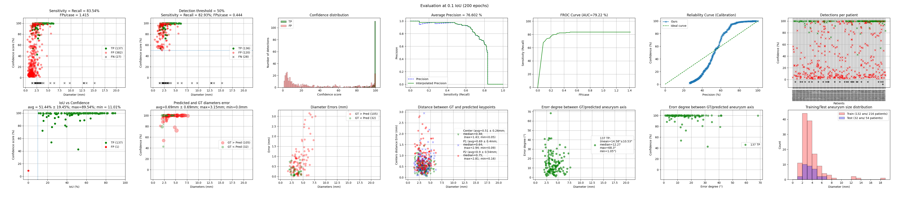

> **Note:** This repository is a copy of the original code hosted at [gitlab.inria.fr/yassis/DeepAnePose](https://gitlab.inria.fr/yassis/DeepAnePose), developed during my PhD at Inria/LORIA.

# DeepAnePose

[](https://github.com/youssefassis/DeepAnePose/actions/workflows/ci.yml)

Detection of intracranial aneurysms in 3D TOF-MRA together with their size and the orientation of their main axis,
for an immediate visualization in reformatted cut planes. This is the code and the annotations of the paper
[Aneurysm Pose Estimation with Deep Learning](https://link.springer.com/chapter/10.1007/978-3-031-43895-0_51)
(MICCAI 2023), packaged as a set of commands that go from scans to detections and evaluation metrics.

## Method
Each aneurysm is approximated by a sphere defined by two points: the center of its neck (P1) and its dome (P2). Inspired
by YOLO, a one-stage network divides each 3D patch into a grid of cells; every cell predicts the confidence that an
aneurysm is centered in it, the position of that center, and the vector from the neck to the center, which gives both
the size and the orientation of the aneurysm. Confidence is trained with a binary cross-entropy loss, position and size
with a mean squared error, and orientation with a cosine similarity loss.

The data strategy of [DeepAneSeg](https://github.com/youssefassis/DeepAneSeg) tackles the class imbalance: fast
two-point annotation, negative patches centered on vessels and in the parenchyma, and aneurysm patches duplicated and
deformed. On 416 patients (317 aneurysms), a 5-fold cross-validation reached a median localization error of 0.48 mm and
a median orientation error of 12.27 degrees; as a detector, an average precision of 76.60%, a sensitivity of 82.93% and
0.44 false positives per case.

<details>
<summary>Abstract</summary>

The diagnosis of unruptured intracranial aneurysms from time-of-flight Magnetic Resonance Angiography (TOF-MRA)
images is a challenging clinical problem that is extremely difficult to automate. We propose to go beyond the mere
detection of each aneurysm and also estimate its size and the orientation of its main axis for an immediate
visualization in appropriate reformatted cut planes. To address this issue, and inspired by the idea behind YOLO
architecture, a novel one-stage deep learning approach is described to simultaneously estimate the localization,
size and orientation of each aneurysm in 3D images. It combines fast and approximate annotation, data sampling and
generation to tackle the class imbalance problem, and a cosine similarity loss to optimize the orientation. We
evaluate our approach on two large datasets containing 416 patients with 317 aneurysms using a 5-fold
cross-validation scheme. Our method achieves a median localization error of 0.48 mm and a median 3D orientation
error of 12.27 degrees, demonstrating an accurate localization of aneurysms and an orientation estimation that
comply with clinical practice. Further evaluation is performed in a more classical detection setting to compare with
state-of-the-art nnDetecton[1] and nnUNet[2] methods. Competitive performance is reported with an average precision
of 76.60%, a sensitivity score of 82.93%, and 0.44 false positives per case.
</details>

Predicted (blue) and ground truth (green) markups on the public dataset [3]; each cut plane rotates around the
predicted aneurysm axis, as displayed by the [slicer-reformat-aneurysm](https://gitlab.inria.fr/yassis/slicer-reformat-aneurysm)
3D Slicer extension:


## Quick start
```
git clone https://github.com/youssefassis/DeepAnePose && cd DeepAnePose
uv sync --extra cu126                                         # or --extra cpu, see Installation
uv run deepanepose-remove-skull data_dir=Data                 # lay out your data as in Data
uv run deepanepose-extract-points data_dir=Data
uv run deepanepose-train data_dir=Data data.split_file=reproducibility/fold1.json name=fold1
uv run deepanepose-predict train_dir=Data/0Work/fold1
uv run deepanepose-evaluate train_dir=Data/0Work/fold1 predictions=Data/0Work/fold1/prediction/200_epochs
```
Each step is described in [Usage](#usage), and its results in [Outputs](#outputs).

## Installation
The project uses [uv](https://docs.astral.sh/uv/) and Python 3.10+. From the repository folder, pick the PyTorch
build:
```
uv sync --extra cu126    # NVIDIA GPU (CUDA 12.6)
uv sync --extra cpu      # CPU only, also the build used on macOS
```
This creates `.venv` with the exact versions of `uv.lock`. Commands then run with `uv run`, or directly once `.venv`
is activated.

Without uv, `pip install git+https://github.com/youssefassis/DeepAnePose` installs the package and its commands
(with PyTorch's default build from PyPI).

## Data
### Layout
Each patient is a folder, either `P0001`-like or `sub-XXX/ses-YYYYMMDD` as in the public dataset [3]:
```
Data/
  P0001/
    volume.nii.gz    TOF-MRA scan
    aneurysms.csv    aneurysms: two points (x, y, z columns, in mm) per aneurysm, see Annotation
    config.json      {"init volume": "volume.nii.gz"}
    noskull.nii.gz   skull-stripped scan (written by deepanepose-remove-skull)
    points.csv       negative patch centers (written by deepanepose-extract-points)
  sub-013/
    ses-20101220/
  ...
  0Work/             trainings and logs (see Outputs)
```
Patients without aneurysm have no `aneurysms.csv`. Coordinates are in the scanner (RAS) space of the NIfTI file. A
split file lists the training, validation and testing patient folders, relative to the data folder or absolute, as in
`reproducibility/fold1.json`.

## Annotation
Each aneurysm is approximated by a sphere defined by two points: the center of its neck (P1) and its dome (P2). The
[slicer-sphere-annotation](https://gitlab.inria.fr/yassis/slicer-sphere-annotation) 3D Slicer extension places them
in the volume rendering view, with a real-time display of the sphere in the canonical cut planes.

<div align="center">
    
</div>

## Usage
**1. Preprocessing:** skull-strip the scans, then select the negative patch centers.
```
uv run deepanepose-remove-skull data_dir=Data
uv run deepanepose-extract-points data_dir=Data
```

**2. Training:** outputs go to `Data/0Work/fold1`; running the same command again resumes the training.
```
uv run deepanepose-train data_dir=Data data.split_file=reproducibility/fold1.json name=fold1
```

**3. Prediction:** writes the detections of each validation and testing patient, with the last checkpoint by
default, to `prediction/<epochs>_epochs`. Each detection has its neck (P1) and dome (P2) points, center and radius in
mm, and a confidence between 0 and 1:
```
uv run deepanepose-predict train_dir=Data/0Work/fold1       # checkpoint=150_checkpoint.pytorch tta=false
```
```
{"0": {"P1": [x, y, z], "P2": [x, y, z], "center": [x, y, z], "radius": 2.86, "confidence": 0.996}}
```

**4. Evaluation:** matches the detections, from the most to the least confident, to the aneurysm they overlap most
(IoU ≥ 0.1), and writes a CSV table of the detections and a summary figure of the pose estimation and detection
metrics next to the predictions:
```
uv run deepanepose-evaluate train_dir=Data/0Work/fold1 predictions=Data/0Work/fold1/prediction/200_epochs
```



## Configuration
Settings are [Hydra](https://hydra.cc) configs in `deepanepose/configs/`: one file per command, composed from groups
(`data`, `model`, `optimizer`, `scheduler`, `augmentation`). Any value can be overridden on the command line:
```
uv run deepanepose-train data_dir=Data data.split_file=split.json name=exp2 batch_size=8 optimizer.lr=5e-3
uv run deepanepose-train --cfg job --resolve data_dir=Data data.split_file=split.json name=exp2   # print the config
```
To add an alternative, e.g. another optimizer, add a file with a `_target_` class to the group, such as
`deepanepose/configs/optimizer/adam.yaml`, and select it with `optimizer=adam`.

Runs are reproducible: `seed` (0 by default) fixes the training, and each training records its git commit and library
versions in `run_info.json`. For identical GPU runs, also set `deterministic=true` (slower).

## Outputs
Everything is written under `Data/0Work`:
```
logs/                            logs of the preprocessing commands
fold1/                           one training
  .hydra/config.yaml             resolved configuration, read back by deepanepose-predict and deepanepose-evaluate
  run_info.json                  git commit and library versions
  last_checkpoint.pytorch        model after the last epoch, used for prediction by default
  <epoch>_checkpoint.pytorch     model every save_every (10) epochs
  logs/                          TensorBoard logs: uv run tensorboard --logdir Data/0Work
  train.log
  prediction/<epochs>_epochs/    for each validation and testing patient:
    <patient>.json                 detections (P0001.json, sub-013_ses-20101220.json)
    detection_evaluation@0.1.csv   matched detections, written by deepanepose-evaluate
    Evaluation@0.1.png             evaluation figure
```

## Requirements
- **Memory:** training keeps the training and validation scans in memory, 8 bytes per voxel: 300 MiB for a
  512×512×150 scan.
- **GPU:** the network has 34.1 M parameters (130 MiB). Its memory use comes mostly from the batch of 32 patches of
  96³ voxels, with mixed precision; if the GPU runs out of memory, lower `batch_size`.

## Reproducing the paper
- `reproducibility/annotations`: annotations of the public dataset [3] (to download from
  [OpenNeuro ds003949](https://openneuro.org/datasets/ds003949/)), one JSON file per subject. Write them as the
  `aneurysms.csv` of each patient folder with:
  ```
  uv run deepanepose-convert-annotations annotations_dir=reproducibility/annotations data_dir=Data
  ```
- `reproducibility/fold1.json` to `fold5.json`: the 5-fold cross-validation splits, one training each:
  ```
  uv run deepanepose-train data_dir=Data data.split_file=reproducibility/fold1.json name=fold1
  ```

## Development
```
uv run pytest               # tests
uv run ruff check .         # lint
uv run ruff format .        # formatting
```
The code is organised as follows:
```
deepanepose/
  cli/           commands
  configs/       Hydra configuration
  data/          patient data I/O, patch sampling, augmentation transforms
  volume/        patch extraction, sphere burning, point selection, skull stripping
  models/        YOLO-like pose estimation network
  training/      dataset, balanced batch sampler, losses, schedulers, trainer
  inference/     patch-wise prediction, detection matching and evaluation
reproducibility/ annotations of the public dataset and cross-validation splits
```

## Citation
If you find this work useful, please cite the papers (also available from "Cite this repository" on GitHub):
```
@inproceedings{assis2023aneurysm,
  title={Aneurysm Pose Estimation with Deep Learning},
  author={Assis, Youssef and Liao, Liang and Pierre, Fabien and Anxionnat, Ren{\'e} and Kerrien, Erwan},
  booktitle={International Conference on Medical Image Computing and Computer-Assisted Intervention},
  pages={543--553},
  year={2023},
  organization={Springer}
}

@inproceedings{assis2021efficient,
  title={An efficient data strategy for the detection of brain aneurysms from MRA with deep learning},
  author={Assis, Youssef and Liao, Liang and Pierre, Fabien and Anxionnat, Ren{\'e} and Kerrien, Erwan},
  booktitle={Deep Generative Models, and Data Augmentation, Labelling, and Imperfections: First Workshop, DGM4MICCAI 2021, and First Workshop, DALI 2021, Held in Conjunction with MICCAI 2021, Strasbourg, France, October 1, 2021, Proceedings 1},
  pages={226--234},
  year={2021},
  organization={Springer}
}
```

## References
[1] Baumgartner et al., nnDetection: A self-configuring method for medical object detection. MICCAI, pp. 530–539
(2021).

[2] Isensee et al., nnU-Net: a self-configuring method for deep learning-based biomedical image segmentation. Nature
Methods 18(2), pp. 203–211 (2021).

[3] Di Noto et al., Towards automated brain aneurysm detection in TOF-MRA: open data, weak labels, and anatomical
knowledge. Neuroinformatics, pp. 1–14 (2022).

## Acknowledgements
This work was funded by the Grand-Est Region and the University Hospital (CHRU) of Nancy, France.
